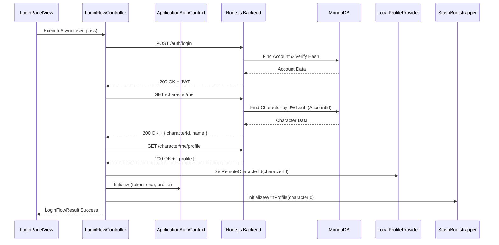

# Remote Identity and Authentication Architecture

## Context

Project Grimhold is transitioning towards a persistent, authoritative backend architecture. To support persistent progression, inventory, and social features, players require stable, globally unique identities that transcend local device state. Previously, identities were generated locally per-process as random GUIDs.

## Decision

The backend Node.js + MongoDB infrastructure is the sole authority over player accounts and characters. Unity authenticates with the backend and receives a token and an identity, which it then uses for all subsequent interactions.

### Authentication & Authorization

1.  **Identity Provider**: A custom Express.js backend running against a MongoDB instance.
2.  **Authentication Protocol**: HTTP POST to `/auth/login` with `username` and `password`.
3.  **Token Standard**: JSON Web Tokens (JWT) signed using a symmetric secret (`JWT_SECRET`).
4.  **Token Lifecycle**:
    *   Tokens are short-lived (configurable via `JWT_EXPIRES_IN`).
    *   The `sub` claim contains the internal `AccountId`.
    *   Tokens are passed in the `Authorization: Bearer <token>` header for all authenticated requests.
    *   Unity treats the JWT as an opaque string. It never attempts to decode or validate the signature client-side.

### Data Model & Boundaries

The backend maintains strict separation between the authentication concept (`Account`) and the gameplay concept (`Character`).

*   **Account**: Represents login credentials (`username`, `passwordHash`).
*   **Character**: Represents the player's avatar in the game world (`name`, `profile`).
    *   Currently, the system enforces a strict 1:1 relationship: One Account owns exactly One Character.
    *   The `accountId` acts as the foreign key linking a Character to an Account.
    *   **AccountId Opacity**: The `AccountId` is strictly an internal backend construct. It never travels in JSON response bodies to Unity, nor is it stored in Unity's memory. It only exists within the JWT `sub` claim.
*   **CharacterId / ProfileId**: The canonical identifier for a character is its MongoDB `_id` (`ObjectId`). When serialized to Unity, this is sent as the `characterId`.
    *   Unity adopts this remote `CharacterId` as its local `ProfileId`.
    *   This is the identity used for Town matchmaking, Stash allocation, and Fusion networking.

### Unity Client Architecture

The authentication flow is orchestrated by `LoginFlowController`, a non-UI component that executes the sequence:

1.  `AuthenticationClient.PostLoginAsync` -> Retrieves JWT.
2.  `CharacterClient.GetCharacterAsync` -> Retrieves `CharacterId` and name.
3.  `CharacterClient.GetProfileAsync` -> Retrieves the profile snapshot (e.g., `customNote`, `lastSeen`).
4.  Injects the remote `CharacterId` into `LocalProfileProvider`.
5.  Populates `ApplicationAuthContext` with the active token and character data.
6.  Invokes `ApplicationStashServiceBootstrapper.InitializeWithProfile` to spin up the local stash bound to this identity.

### Logout & Session Revocation Lifecycle (US-60)

The session lifecycle is completed by allowing the user to explicitly log out from the Town or MainMenu. Under US-60, logout provides authoritative server-side session invalidation:

1.  **UI Trigger**: The player clicks "Logout" in the Town menu or MainMenu.
2.  **Session Disconnect**: The `SessionConnectionCoordinator` cleanly tears down the active network runner (e.g. disconnecting from the Town) and returns the application state to the MainMenu.
3.  **Client-Side Teardown & Backend Revocation**: `LoginFlowController.ExecuteLogoutAsync()` is called, which:
    *   Calls the backend `POST /auth/logout` endpoint with the active JWT (`Authorization: Bearer <token>`).
    *   **Authoritative Revocation**: The backend computes a SHA-256 hash of the token (`tokenHash`), extracts its `jti` (unique UUID embedded upon issuance) and natural expiration (`exp`), and stores a record in the MongoDB `RevokedToken` collection.
    *   **Automated Pruning**: A MongoDB TTL index on `expiresAt` (`expireAfterSeconds: 0`) ensures revoked tokens are automatically deleted once they naturally expire, preventing unbounded database growth.
    *   **Rejection of Revoked Tokens**: The `authenticate` middleware checks incoming token hashes against `RevokedToken.exists({ tokenHash })`. Any request presenting a revoked token is rejected with `401 UNAUTHORIZED` ("Token has been revoked."). Other concurrent sessions remain unaffected because tokens are hashed individually.
    *   Invokes `ApplicationStashServiceBootstrapper.ResetForLogout()` to tear down the in-memory Stash and Loadout state for the previous user. The context GameObject is kept alive to support subsequent logins without a process restart.
    *   Clears the local `ApplicationAuthContext` (discarding the JWT).
    *   Clears the `LocalProfileProvider` (discarding the remote `CharacterId`).
4.  **Re-authentication**: The player is returned to the `LoginPanelView` and can authenticate with a different account. A successful new login will re-initialize the `ApplicationStashServiceBootstrapper` with the new account's `ProfileId`.

### Security Hardening & Rate Limiting (US-60)

To protect the authentication and gameplay infrastructure in staging and production environments, the backend implements defense-in-depth controls:

1.  **Rate Limiting**:
    *   **IP Sliding Window Limiter**: Guards `/auth/login` and `/auth/register` (e.g., 20 requests per minute per IP), preventing denial-of-service and credential stuffing floods. Exceeding the threshold returns `429 TOO_MANY_REQUESTS`.
    *   **User Failed Login Limiter**: Tracks failed authentication attempts per username/account (e.g., 5 failures within 15 minutes). Once locked out, further login attempts for that account return `429 TOO_MANY_REQUESTS` ("Account temporarily locked due to too many failed attempts. Please try again later."). Successful login immediately resets the failure counter.
    *   **Unity Client Handling**: `LoginFlowController` and `BackendErrorUtility` detect `TOO_MANY_REQUESTS` and report clear user-facing guidance rather than generic failure messages.
2.  **Environment Hardening**:
    *   **Production Secret Enforcement**: In `production` (`NODE_ENV === 'production'`), weak or default JWT secrets are strictly rejected; secrets must be at least 32 characters long.
    *   **Debug & Mock Route Elimination**: Development helper routes (`/character/debug/mock-fusion-result`, `/character/me/inventory/extraction`) are gated behind dynamic environment getters (`enableDebugRoutes`, `enableLegacyExtraction`). In `production`, these routes are permanently disabled and return `404 Not Found`.
    *   **500 Error Sanitization**: Unhandled exceptions in the Express pipeline are sanitized by `errorHandler`. Internal error messages, database schemas, and stack traces are suppressed, returning a safe, generic payload: `{ error: "INTERNAL_SERVER_ERROR", message: "An unexpected error occurred." }`.

### Constraints & Future Work

*   **No Direct DB Access**: Unity never talks directly to MongoDB. All communication is via HTTP REST to the backend.
*   **Fusion Identity & Session Verification (US-59 / SEC-59.1)**: Photon Fusion receives the `ProfileId` to identify players in a session. Under US-59, the client does not demonstrate identity merely with a locally declared `ProfileId`, visible name or controlling a `PlayerObject`.
    - **Town Session Verification**: The backend acts as the sole authoritative issuer, generating a short-lived `TownSessionTicket` via `POST /character/me/session-ticket/town` signed with HMAC-SHA256 (`characterId`, `characterName`, `sessionName: 'Lobby-Town'`, `expiresAt`). The Town State Authority (`TownPartyDirectory`, `TownMerchantNetworkController`) verifies this ticket via `ITownSessionTicketVerifier` before authorizing party modifications or merchant operations.
    - **Authoritative Raid Admission**: Clients obtain an `AuthoritativeRaidAdmissionTicket` via `POST /character/me/raid/admission-ticket`, binding their connection to an active backend `pendingReservation` (`reservationId`, `raidCode`, `characterAttributes`, `level`, `experience`, `preparedAbilities`, `items`, `preparedEquipment`). The Raid Host verifies the ticket via `IRaidAdmissionVerifier` and spawns the avatar using exclusively the backend-verified snapshot, rejecting client-fabricated attributes or unreserved items.
    - **Issuer Secrets Isolation**: Neither `JWT_SECRET` nor backend private keys are compiled into client builds. Verification is performed through backend endpoints or decoupled verifier interfaces.
*   **HTTPS**: Development currently occurs over HTTP. Production deployments must enforce HTTPS for all backend communication to secure credentials and JWTs in transit.
*   **Temporary Persistence**: While `customNote` and `lastSeen` persist remotely, core gameplay state (Stash, Loadout, Receipts) currently remains local and temporary per process (as defined in `LocalPlayerPersistenceArchitecture.md`). Subsequent roadmap stages will migrate these to the authoritative backend.
*   **Authoritative Session Revocation**: Accomplished in US-60 via SHA-256 token hashing and MongoDB TTL collections.
*   **Extraction Result Producer Boundary & Simulation Trust (#400)**: While the backend cryptographically authenticates raid results (`AuthoritativeExtractionResult`) via HMAC-SHA256 signatures over a canonical pipe-delimited payload, in the current Listen Server MVP the Host runs the simulation and generates the signature. Real producer isolation requires Dedicated Servers (#400), where the secret and simulation authority are hosted on secure infrastructure out of reach of player clients. Full details and anti-replay invariants are specified in `ExtractionArchitecture.md`.

