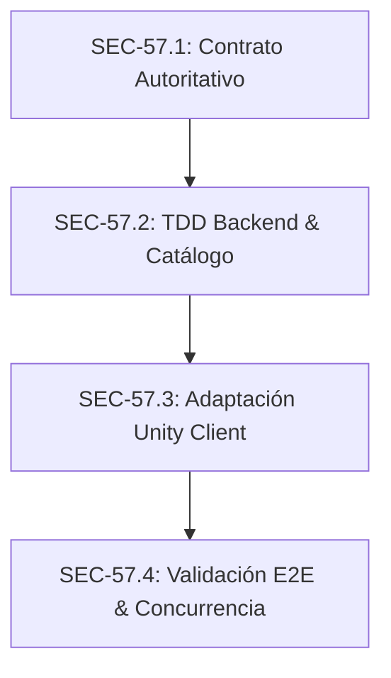

# Plan de Implementación y Ejecución: US-57 — Asegurar el catálogo y los valores autoritativos del Shop

> **Historia madre:** [US-57 (#525)](https://hacknplan.com)  
> **Tareas hijas:**  
> - [SEC-57.1 (#532)](https://hacknplan.com) — Definir el contrato autoritativo de catálogo, precios y cantidades  
> - [SEC-57.2 (#533)](https://hacknplan.com) — Validar compras y ventas contra valores calculados por el backend  
> - [SEC-57.3 (#534)](https://hacknplan.com) — Adaptar el Shop de Unity al contrato económico seguro  
> - [SEC-57.4 (#535)](https://hacknplan.com) — Validar conservación de inventario y moneda de punta a punta  
> **Sprint:** 14  
> **Prioridad:** Urgent  
> **Fuentes autoritativas:**  
> - `GD-14 — Objetos, Recursos y Consumibles` (Sección 7: Valor de Objeto, Sección 14: Tabla maestra de Value del catálogo MVP)  
> - `Project Grimhold/Docs/Architecture/CommerceArchitecture.md`  
> - `Project Grimhold/Docs/Architecture/LocalPlayerPersistenceArchitecture.md`  

---

## 1. Diagnóstico del Error y Estado Vigente

### Evidencia Confirmada en Auditoría
- **`backend/src/validators/inventory.validators.js`:**  
  Validaba únicamente que `declaredPrice` y `declaredSellValue` fueran enteros no negativos (`min: 0`), permitiendo valores arbitrarios fijados por el cliente.
- **`backend/src/services/InventoryService.js`:**  
  - En `shopBuy`: aplicaba `$inc: { 'inventory.currency': -declaredPrice }` y añadía `amount` ítems al `loadout`. Un cliente malicioso enviaba `declaredPrice: 0` y `amount: 1000000`, obteniendo un millón de unidades sin costo.
  - En `shopSell`: aplicaba `$inc: { 'inventory.currency': declaredSellValue }`. Un cliente enviaba `declaredSellValue: 1000000000` y `amount: 1`, acreditando mil millones de oro al vender un solo ítem.
- **Ausencia de Catálogo Autoritativo en Backend:**  
  No existía validación contra ofertas activas, ítems del catálogo o precios unitarios autorizados por Game Design.
- **Vulnerabilidad de Recibos (`appliedShopReceipts`):**  
  Almacenaba únicamente `{ transactionId, type, timestamp }`. No registraba `lootId`, `amount` ni monto económico, permitiendo reutilizar un `transactionId` previo con una intención fraudulenta.
- **Contrato Unity (`RemoteShopTransactionService.cs`):**  
  Pasaba `line.Total` a `InventoryClient.ShopBuyAsync` y `ShopSellAsync`, declarando precios desde el cliente en lugar de solicitar la intención pura de la transacción.

---

## 2. Alcance y Límites del Trabajo

### Dentro del Alcance
1. Eliminar la confianza en `declaredPrice` y `declaredSellValue` en el backend.
2. Definir e implementar un catálogo autoritativo de ítems y ofertas en el backend (`backend/src/config/shopCatalog.js`) derivado de GD-14.
3. Validación estricta de cantidades (`1 <= amount <= MAX_TRANSACTION_AMOUNT`), tipos y aritmética segura contra desbordamientos.
4. Protección atómica y transaccional en MongoDB (fondos suficientes, posesión de ítems, concurrencia y conflicto de revisiones).
5. Binding estricto de recibos de compra/venta para evitar reutilización maliciosa de `transactionId`.
6. Adaptación de DTOs y clientes en Unity (`InventoryClient.cs`, `RemoteShopTransactionService.cs`) para enviar intención pura y reconciliar UI con la confirmación del servidor.
7. Suite completa de tests unitarios (TDD RED -> GREEN) e integración end-to-end con MongoDB en memoria y pruebas EditMode en Unity.

### Fuera de Alcance
- Nuevo gameplay del mercader o reposición/rotación dinámica de stock.
- Rebalanceo económico o cambios en `ObjectValue` sin aprobación explícita de Game Design.
- Frameworks genéricos de economía.
- Soporte multilínea remoto (el backend procesa transacciones atómicas por ítem en este alcance; Unity preserva tickets atómicos individuales).

---

## 3. Plan de Ejecución por Etapas

### Etapa 1: SEC-57.1 (#532) — Definir el contrato autoritativo de catálogo, precios y cantidades
**Objetivo:** Formalizar la fuente de verdad del backend, los DTOs de intención, el catálogo base y el esquema de errores.

1. **Definición de Catálogo Autoritativo (`backend/src/config/shopCatalog.js`):**
   - Catálogo de compra (`BUYABLE_ITEMS`): Ítems ofrecidos (`healthpotion` / `health_potion`, `bone`, equipamiento básico) con precio unitario en oro (`buyPrice`).
   - Catálogo de venta (`SELLABLE_ITEMS`): Ítems que el mercader compra con su valor unitario en oro (`sellValue`).
   - Normalización de identificadores (`normalizeLootId`).
   - Distinción explícita de ofertas legítimamente gratuitas (`isFree: true`) frente a valores 0 falsificados.
2. **Límites Numéricos y Aritmética Segura:**
   - Constante `MAX_TRANSACTION_AMOUNT = 999` por operación.
   - Verificación con `Number.isSafeInteger(amount)` y `Number.isSafeInteger(amount * unitPrice)`.
3. **Contrato de Endpoints:**
   - `POST /character/me/inventory/shop/buy`:
     - Payload requerido: `{ transactionId: string, lootId: string, amount: int, expectedRevision: int }`
     - Campo opcional/ignorado: `declaredPrice` (ignorado por el servidor para compatibilidad).
   - `POST /character/me/inventory/shop/sell`:
     - Payload requerido: `{ transactionId: string, lootId: string, amount: int, expectedRevision: int }`
     - Campo opcional/ignorado: `declaredSellValue` (ignorado por el servidor).
4. **Respuestas y Errores Tipados:**
   - `200 OK`: `{ revision, currency, loadout, stash, preparedEquipment, alreadySecured? }`
   - `400 Bad Request`: `INVALID_QUANTITY`, `INVALID_PAYLOAD`, `INTEGER_OVERFLOW`.
   - `404 Not Found`: `CHARACTER_NOT_FOUND`, `ITEM_NOT_OFFERED`, `ITEM_NOT_SELLABLE`.
   - `409 Conflict`: `INSUFFICIENT_FUNDS`, `INSUFFICIENT_ITEMS`, `REVISION_CONFLICT`, `TRANSACTION_ID_REUSED`.
5. **Actualización de Documentación Técnica:**
   - `Project Grimhold/Docs/Architecture/CommerceArchitecture.md` documenta la sección "Backend Authoritative Contract (US-57 / SEC-57.1)".

---

### Etapa 2: SEC-57.2 (#533) — Validar compras y ventas contra valores calculados por el backend
**Objetivo:** Implementar en el backend el cálculo autoritativo y las validaciones de seguridad mediante TDD (Test-Driven Development).

1. **Fase RED (Reproducción de exploits en tests):**
   - Crear `backend/tests/inventory.shop.test.js`:
     - Cliente intenta comprar 1.000.000 ítems con `declaredPrice: 0`.
     - Cliente intenta vender 1 ítem con `declaredSellValue: 1000000000`.
     - Compra de ítem fuera del catálogo de compra.
     - Compra con fondos inferiores al costo autoritativo (`unitPrice * amount`).
     - Venta de ítems no poseídos en `loadout`.
     - Cantidades no enteras, `<= 0`, o `> MAX_TRANSACTION_AMOUNT`.
     - Mismo `transactionId` con payload diferente rechazado con `409 TRANSACTION_ID_REUSED`.
2. **Fase GREEN (Implementación en backend):**
   - `backend/src/config/shopCatalog.js`: Mapeos inmutables y consultas `getBuyOffer(lootId)` y `getSellOffer(lootId)`.
   - `backend/src/validators/inventory.validators.js`: `amount` restringido a entero `[1, MAX_TRANSACTION_AMOUNT]`. Precios del cliente marcados opcionales e ignorados.
   - `backend/src/models/Character.js`: Extender `shopReceiptSchema` para persistir `lootId: String, amount: Number, totalAmount: Number` (evitando que Mongoose los descarte en `$push`).
   - `backend/src/services/InventoryService.js`:
     - Validación de coincidencia estricta en recibos existentes (`transactionId`, `type`, `lootId`, `amount`).
     - Cálculo seguro en servidor: `authoritativeCost = offer.buyPrice * amount` / `authoritativeRevenue = offer.sellValue * amount`.
     - Actualización atómica en MongoDB:
       - Compra: `{ accountId, revision: expectedRevision, 'inventory.currency': { $gte: authoritativeCost } }` con `$inc: { revision: 1, 'inventory.currency': -authoritativeCost }`.
       - Venta: comprobación de posesión en `loadout` y actualización atómica con `$inc: { revision: 1, 'inventory.currency': authoritativeRevenue }`.
       - Registro completo en `appliedShopReceipts`.

---

### Etapa 3: SEC-57.3 (#534) — Adaptar el Shop de Unity al contrato económico seguro
**Objetivo:** Adaptar el cliente Unity para que actúe exclusivamente como emisor de intenciones y reconcilie la UI a partir de las confirmaciones del backend.

1. **Actualizar DTOs (`InventoryDataTransferObjects.cs`):**
   - En `ShopBuyRequest` y `ShopSellRequest`: omitir campos `declaredPrice` y `declaredSellValue`.
2. **Actualizar Cliente HTTP (`InventoryClient.cs`):**
   - `ShopBuyAsync` y `ShopSellAsync` actualizados para no recibir ni serializar precios de cliente.
3. **Actualizar Persistencia Remota (`RemoteShopTransactionService.cs`):**
   - `ExecutePurchaseAsync` y `ExecuteSaleAsync` invocan al cliente HTTP enviando únicamente `line.LootId.Value`, `line.Amount`, `transactionId` y `_store.RemoteRevision`.
   - Al recibir confirmación, aplica `_store.SetRemoteRevision(data.revision)`.
   - Ante rechazo (ej. `INSUFFICIENT_FUNDS`), `RemoteOperationPolicy` invoca la reconciliación con el servidor.
4. **Preservación de la UI y Preview Local:**
   - La previsualización en `MerchantTradeDraft`, `MerchantTradePreview` y `TownMerchantPresenter` se mantiene intacta como ayuda visual para el jugador usando `LootDefinitionCatalog`, sin adjudicarse autoridad transaccional.
5. **Corrección de Prefab en Tests:**
   - Corregir ruta en `MerchantStockConfigurationTests.cs` (`Assets/Prefabs/Merchant.prefab` -> `Assets/Prefabs/TownMerchantNPC.prefab`).

---

### Etapa 4: SEC-57.4 (#535) — Validar conservación de inventario y moneda de punta a punta
**Objetivo:** Certificar mediante pruebas de integración completas la conservación de estado, aislamiento de cuentas y robustez ante fallos.

1. **Suite de Integración con MongoDB (`backend/tests/integration/shop.authoritative.test.js`):**
   - Compra legítima con fondos suficientes: deducción exacta de oro y acreditación en `loadout`.
   - Venta legítima de ítem poseído: deducción de ítem y acreditación exacta de oro.
   - Intento de compra con `declaredPrice: 0`: cobra el valor autoritativo real.
   - Intento de venta con `declaredSellValue: 1,000,000,000`: acredita únicamente el valor autoritativo real.
   - Fondos insuficientes: rechazo 409 `INSUFFICIENT_FUNDS`, saldo e inventario inalterados.
   - Ítems insuficientes: rechazo 409 `INSUFFICIENT_ITEMS`, saldo e inventario inalterados.
   - Ítems no listados o deshabilitados: rechazo 404 `ITEM_NOT_OFFERED`.
   - Cantidades excesivas (`> 999`): rechazo 400 `INVALID_QUANTITY`.
   - Idempotencia exacta: reintento exacto devuelve 200 con `alreadySecured: true` sin duplicar deducción ni entrega.
   - Conflicto por recibo reutilizado: mismo `transactionId` con payload diferente devuelve 409 `TRANSACTION_ID_REUSED`.
   - Concurrencia de compras: dos compras simultáneas con saldo para una sola; una triunfa y la otra falla limpiamente con 409 sin balance negativo.

---

## 4. Matriz de Trazabilidad de Criterios de Aceptación (US-57)

| Criterio de Aceptación | Tarea Responsable | Verificación y Evidencia Observada |
|---|---|---|
| Compra solo acepta oferta habilitada y cantidad positiva; entradas malformadas/excesivas se rechazan sin mutación. | SEC-57.1, SEC-57.2 | `test_buy_unlisted_item` y `test_amount_limits_and_overflow` pasan en `inventory.shop.test.js`. Rechazo 400/404 sin mutación en `shop.authoritative.test.js`. |
| Precios alterados/cero no alteran el cálculo del servidor; oferta gratuita legítima diferenciada de falsificación. | SEC-57.1, SEC-57.2 | `test_buy_exploit_zero_declared_price` pasa; el servidor cobra el precio autoritativo ignorando el campo del cliente. Distinción explícita de `isFree: true` en `shopCatalog.js`. |
| Venta exige objetos propios y calcula valor desde configuración autoritativa con aritmética segura. | SEC-57.2 | `test_sell_exploit_arbitrary_declared_value` pasa; venta de 1 poción acredita 10 de oro en lugar del billón enviado. Validación de posesión en `loadout` y aritmética con `Number.isSafeInteger`. |
| Compras/ventas legítimas, fondos/ítems insuficientes, revisiones desactualizadas, reintentos y concurrencia conservan resultados. | SEC-57.2, SEC-57.4 | Pruebas de integración E2E en `shop.authoritative.test.js` (12 tests) y `concurrency.test.js` pasan 100%. Saldo y objetos conservados estrictamente. |
| Pruebas por interfaz pública reproducen compra gratuita y venta arbitraria antes de corregirlas y verifican rechazo posterior. | SEC-57.2 | Fase RED observada con 10 tests fallando inicialmente en `inventory.shop.test.js` reproduciendo los exploits; fase GREEN observada tras implementar `InventoryService.js` y `shopCatalog.js`. |
| Integración con MongoDB real y flujo de Unity demuestran conservación de objetos/moneda sin duplicación ante fallos. | SEC-57.3, SEC-57.4 | Suite de integración MongoDB en memoria (`npm run test:integration`: 35/35 passing) y tests EditMode de Unity (`MerchantStockConfigurationTests`: 2/2 passing; `ShopTransactionPersistenceEditModeTests`: 26/26 passing). |

---

## 5. Resumen de Ejecución y Evidencias Observadas

- **Backend Unit Tests:** 89 pasados de 89 (`npm test` en 651ms).
- **Backend Integration Tests:** 35 pasados de 35 (`npm run test:integration` en 1735ms).
- **Backend Concurrency Tests:** 7 pasados de 7 (`npm run test:concurrency`).
- **Unity Compilation:** 0 errores de compilación (`read_console`).
- **Unity EditMode Tests:** 28 tests de comercio y stock ejecutados y aprobados al 100%.
- **HacknPlan Work Items:** US-57 (#525), SEC-57.1 (#532), SEC-57.2 (#533), SEC-57.3 (#534) y SEC-57.4 (#535) sincronizados en `In progress`.
