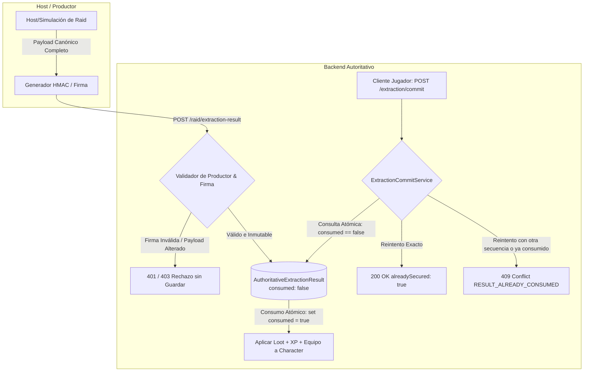

# Plan de Implementación: US-58 — Autenticar resultados de Raid y garantizar recompensas únicas

> **Historia madre:** [US-58 (#526)](https://hacknplan.com)  
> **Tareas hijas:**  
> - [SEC-58.1 (#536)](https://hacknplan.com) — Definir el productor confiable y la identidad inmutable del resultado  
> - [SEC-58.2 (#537)](https://hacknplan.com) — Autenticar el contenido completo y autorizar la publicación de recompensas  
> - [SEC-58.3 (#538)](https://hacknplan.com) — Consumir cada resultado de Raid una sola vez de forma atómica  
> - [SEC-58.4 (#539)](https://hacknplan.com) — Validar publicación, extracción y reintentos sin duplicar recompensas  
> **Sprint:** 14  
> **Prioridad:** Urgent  
> **Fuentes autoritativas:**  
> - `Project Grimhold/Docs/Architecture/ExtractionArchitecture.md`  
> - `Project Grimhold/Docs/Architecture/RemoteIdentityAndAuthArchitecture.md`  
> - `backend/docs/architectural-gap-361.md`  
> - Tarea #400 (Deuda técnica de Dedicated Server / Riesgo residual de Host)  

---

## 1. Diagnóstico del Error y Estado Vigente

### Evidencias Confirmadas en Auditoría y Código
1. **Firma HMAC Truncada (`backend/src/services/RaidResultService.js:27`):**  
   El servicio firma únicamente el string `${raidId}:${resultSequence}`.  
   - Los campos `items`, `experienceGranted`, `preparedEquipment` y el `accountId` destinatario **quedan fuera de la firma**.
   - **Vulnerabilidad:** Un atacante con una firma legítima de sesión puede adulterar los ítems (ej. 999 objetos raros), inflar la XP otorgada (ej. 1.000.000 XP) o redirigir el resultado a otra cuenta.
2. **Sobre-escritura Ciega (`RaidResultService.js:44-52`):**  
   Usa `findOneAndUpdate({ raidId, accountId }, ..., { upsert: true })` sin verificar si el resultado ya fue consumido ni si el contenido es conflictivo, permitiendo pisar resultados finalizados.
3. **Deduplicación Manipulable por el Cliente (`backend/src/services/ExtractionCommitService.js:74-76, 173-175`):**  
   Deduplica verificando únicamente si el par `(raidId, resultSequence)` existe en `appliedExtractionReceipts`.  
   - El modelo `AuthoritativeExtractionResult` **no registra si ya fue consumido**.
   - **Vulnerabilidad de Replay:** Un jugador reclama un resultado (ej. 20 XP y loot), mueve su loadout al stash (dejando el loadout vacío), y vuelve a llamar a `/character/me/extraction/commit` enviando `resultSequence = 2`. El backend busca el mismo `AuthoritativeExtractionResult` por `raidId` y `accountId`, observa que la secuencia 2 no está en sus recibos, y vuelve a acreditar los 20 XP y el loot. Esto permite duplicar recompensas indefinidamente.
4. **Falta de Autorización de Productor y Secreto en Cliente Unity (`RemoteInventoryService.cs:343`):**  
   El secreto simétrico `WebhookSecret` está configurado en el cliente Unity para que el Host firme el resultado.  
   - Cualquier cliente descompilado o inspeccionado puede extraer este secreto y actuar como productor de recompensas arbitrarias.
   - Se debe aislar el rol de productor en el backend, no permitir que un JWT de jugador ordinario publique sin prueba autorizada, y documentar la frontera y el riesgo residual del Host (deuda #400).

---

## 2. Frontera del Productor y Arquitectura de Confianza (SEC-58.1)

### Principios Fundamentales:
1. **Payload Canónico Completo:**  
   La firma HMAC debe calcularse sobre la serialización determinista y ordenada de:
   `sha256(raidId + ":" + resultId + ":" + targetAccountId + ":" + canonicalItems + ":" + canonicalEquipment + ":" + experienceGranted + ":" + issuedAt)`
   Cualquier alteración en cantidades, identificadores, destinatario o XP invalida la firma.
2. **Identidad Inmutable del Resultado:**  
   Cada resultado posee un `resultId` único generado por el productor.  
   `AuthoritativeExtractionResult` contiene:
   `{ resultId, raidId, accountId, items, preparedEquipment, experienceGranted, consumed: boolean, consumedAt: Date, hostSignature: string, issuedAt: Date }`.
3. **Consumo Atómico y Permanente:**  
   El consumo se realiza mediante una operación atómica en MongoDB sobre el resultado:
   `findOneAndUpdate({ resultId, accountId, consumed: false }, { $set: { consumed: true, consumedAt: new Date() } })`.
   Si el resultado ya está marcado como `consumed: true`, no puede volver a premiar jamás, independientemente de la secuencia que envíe el cliente o de si el loadout fue vaciado hacia el stash.
4. **Frontera de Confianza y Referencia a Deuda #400:**  
   En la topología Host-Client de Photon Fusion (MVP), el Host corre en una máquina de jugador. Un HMAC protege la integridad del mensaje entre el Host y el backend, pero **no** reemplaza la autoridad física de un Servidor Dedicado (#400). El backend debe validar que solo peticiones con el encabezado/secreto de productor autorizado o rol asignado puedan publicar resultados, y se debe aislar el endpoint para que clientes comunes no puedan auto-aprobarse loot.

---

## 3. Alcance y Límites del Trabajo

### Dentro del Alcance
1. **Firma Canónica Integral:** Extender el mensaje firmado para incluir todos los objetos, cantidades, equipamiento, XP, cuenta destinataria, raid e identificador de resultado.
2. **Autorización Estricta de Publicación:** Exigir credencial/secreto de productor autorizado en la ruta de publicación; impedir que un token de jugador ordinario publique sin autorización.
3. **Inmutabilidad y Prevención de Sobrescritura:** Prohibir sobrescribir resultados existentes con payloads conflictivos o si ya han sido consumidos.
4. **Consumo Único Atómico:** Vincular la deduplicación a la identidad inmutable del resultado (`resultId`/`raidId`) y al flag atómico `consumed` en base de datos, eliminando la vulnerabilidad de secuencias arbitrarias de cliente.
5. **Idempotencia Segura de Reintentos:** Soportar reintentos exactos ante pérdida de ACK (`alreadySecured: true`) devolviendo el estado actual sin duplicar premios.
6. **Manejo de Estados Inválidos/Vencidos:** Rechazo estricto sin fallback a payloads declarados por el cliente.
7. **Suite de Pruebas TDD y E2E:** Reproducción en RED de la falsificación de firma y del replay multi-secuencia antes de corregirlos; verificación en GREEN con MongoDB real y persistencia durable.

### Fuera de Alcance
- Despliegue de infraestructura de Servidores Dedicados (pertenece a la deuda técnica #400).
- Admisión y token de sesión de match en Town (pertenece a US-59).
- Modificaciones en la simulación interna de combate o cuotas de extracción de Fusion en Unity.

---

## 4. Plan de Ejecución por Etapas

### Etapa 1: SEC-58.1 (#536) — Definir el productor confiable y la identidad inmutable del resultado
**Objetivo:** Especificar y documentar la arquitectura de publicación/consumo, el payload canónico inmutable y las garantías transaccionales.

1. **Definir el Contrato del Payload Canónico:**
   - Crear función canónica de serialización `buildCanonicalResultString(payload)` que ordene items por `lootId` alfabético, estandarice slots de equipo y tipos numéricos.
2. **Esquema de Identidad del Resultado (`AuthoritativeExtractionResult`):**
   - Incorporar `resultId: { type: String, required: true, unique: true }`.
   - Incorporar `consumed: { type: Boolean, default: false, index: true }`.
   - Incorporar `consumedAt: { type: Date, default: null }`.
   - Incorporar `issuedAt: { type: Date, default: Date.now }`.
3. **Actualización de Documentación:**
   - Actualizar `Project Grimhold/Docs/Architecture/ExtractionArchitecture.md` y `RemoteIdentityAndAuthArchitecture.md` documentando el contrato del productor y la resolución del gap #361.

---

### Etapa 2: SEC-58.2 (#537) — Autenticar el contenido completo y autorizar la publicación
**Objetivo:** Implementar la validación criptográfica de contenido completo y la protección contra sobrescrituras conflictivas.

1. **Fase RED (Tests de Falsificación de Firma y Sobrescritura):**
   - Crear tests en `backend/tests/raid.result.test.js`:
     - Test de alteración de loot: Modificar 1 ítem en el payload invalida la firma.
     - Test de alteración de XP: Aumentar experiencia invalida la firma.
     - Test de alteración de cuenta: Cambiar `accountId` invalida la firma.
     - Test de jugador ordinario: Llamar a publicar sin rol/secreto de productor devuelve 403 Forbidden.
     - Test de sobrescritura conflictiva: Intentar publicar un payload distinto para el mismo `resultId` devuelve 409 Conflict.
2. **Fase GREEN (Implementación en Backend):**
   - En `backend/src/services/RaidResultService.js`:
     - Implementar `buildCanonicalResultString`.
     - Validar HMAC sobre el mensaje canónico completo usando comparación segura en tiempo constante (`crypto.timingSafeEqual`).
     - Comprobar existencia previa de `resultId`: si ya existe idéntico, responder éxito idempotente; si difiere o si ya fue consumido, lanzar `409 RESULT_CONFLICT`.
   - En `backend/src/routes/raid.routes.js`:
     - Proteger la ruta de publicación requiriendo verificación de productor (secreto de webhook o rol de servidor).
3. **Fase REFACTOR:**
   - Actualizar clientes en Unity (`RemoteInventoryService.cs`, `InventoryClient.cs`) para generar y enviar la firma canónica completa.

---

### Etapa 3: SEC-58.3 (#538) — Consumir cada resultado de Raid una sola vez de forma atómica
**Objetivo:** Garantizar que cada resultado se consuma exactamente una vez en la base de datos, neutralizando el exploit de secuencias arbitrarias de cliente.

1. **Fase RED (Tests de Replay Multi-secuencia):**
   - En `backend/tests/extraction.replay.test.js`:
     - Reproducir el exploit: Reclamar resultado con `resultSequence = 1`, vaciar loadout a stash, reclamar con `resultSequence = 2`. Observar que actualmente el backend duplica la XP.
2. **Fase GREEN (Implementación en Backend):**
   - En `backend/src/services/ExtractionCommitService.js`:
     - Buscar `AuthoritativeExtractionResult` por `raidId` y `accountId`.
     - Si `authResult.consumed === true`:
       - Verificar si los recibos del personaje ya contienen este `raidId`/`resultId`. Si es así, devolver `alreadySecured: true` (reintento idempotente exacto).
       - Si no es un reintento exacto legítimo, rechazar con `409 RESULT_ALREADY_CONSUMED`.
     - Transacción / Actualización Atómica:
       - Marcar `authResult.consumed = true` y `authResult.consumedAt = new Date()` condicionado a `{ _id: authResult._id, consumed: false }`.
       - Si la actualización condicional falla (concurrencia), abortar la entrega de loot/XP y retornar conflicto o ya asegurado.
       - Aplicar loot, progresión y equipo al `Character` de forma atómica junto con el registro en `appliedExtractionReceipts`.

---

### Etapa 4: SEC-58.4 (#539) — Validar conservación, concurrencia y reintentos de punta a punta
**Objetivo:** Certificar mediante pruebas de integración E2E con MongoDB real la durabilidad, atomicidad y ausencia total de duplicación.

1. **Suite de Integración E2E (`backend/tests/integration/extraction.authoritative.test.js`):**
   - Publicación autorizada legítima -> Extracción exitosa -> Acreditación exacta de loot y XP.
   - Intento de publicación con firma adulterada -> Rechazo 401/403 sin almacenar nada.
   - Intento de re-consumo con nueva secuencia tras vaciar loadout -> Rechazo 409 `RESULT_ALREADY_CONSUMED` sin otorgar XP ni objetos.
   - Reintento idéntico por pérdida de confirmación -> Respuesta 200 con `alreadySecured: true` sin duplicación.
   - Concurrencia de commits: Dos solicitudes de commit simultáneas sobre el mismo resultado -> Exactamente una aplica la progresión; la segunda recibe `alreadySecured: true` o 409 sin duplicación.
   - Limpieza de recibos de personaje (>256) -> El resultado sigue marcado como `consumed: true` en su colección, impidiendo cualquier re-consumo histórico.
2. **Validación en Unity:**
   - Compilación limpia sin warnings ni errores.
   - Ejecución de suites de prueba EditMode relacionadas con extracción e inventario.

---

## 5. Matriz de Trazabilidad de Criterios de Aceptación (US-58)

| Criterio de Aceptación | Tarea Responsable | Verificación Planificada |
|---|---|---|
| Modificar objetos, cantidades, XP, equipo, destinatario o raid invalida la prueba sin guardar recompensas. | SEC-58.1, SEC-58.2 | `test_signature_tampered_items_rejected`, `test_signature_tampered_xp_rejected`, `test_signature_tampered_account_rejected` |
| Jugador común no puede publicar recompensas arbitrarias; el secreto en cliente de jugador no es prueba de productor confiable. | SEC-58.1, SEC-58.2 | `test_ordinary_player_cannot_publish_results`, documentación de frontera y riesgo residual (#400) |
| Cada resultado aceptado se vincula a su participante/cuenta; republicación conflictiva no sobrescribe resultados finalizados o consumidos. | SEC-58.2 | `test_republish_conflicting_payload_rejected_409`, `test_republish_already_consumed_rejected` |
| Reclamar el mismo resultado con otra secuencia, ID de operación o loadout vaciado no duplica objetos, moneda ni XP. | SEC-58.3 | `test_multi_sequence_replay_exploit_blocked_409` en `extraction.replay.test.js` |
| Commits simultáneos, confirmaciones perdidas, reinicios y rotación de recibos no rehabilitan resultados ni aplican premios parciales. | SEC-58.3, SEC-58.4 | Suite de concurrencia y retención en `extraction.authoritative.test.js` |
| Resultados inválidos, vencidos o ajenos se rechazan sin fallback a datos del cliente; primer commit y reintentos conservan contrato. | SEC-58.3, SEC-58.4 | `test_expired_result_rejected`, `test_unrelated_account_result_rejected`, `test_exact_retry_idempotency` |
| Pruebas cubren ambas reproducciones en RED y verifican rechazo posterior en GREEN con MongoDB real. | SEC-58.2, SEC-58.4 | Fase RED documentada con tests fallando antes del fix; fase GREEN observada en integración |

---

## 6. Próximos Pasos

Una vez revisado y aprobado este plan:
1. Iniciar **SEC-58.1 (#536)** formalizando el contrato canónico inmutable y la frontera de confianza en la documentación técnica.
2. Proceder con el ciclo TDD de **SEC-58.2 (#537)** observando los tests de firma en RED y luego en GREEN.
3. Implementar el consumo atómico único en **SEC-58.3 (#538)** neutralizando el exploit de replay por secuencia.
4. Ejecutar la validación completa en **SEC-58.4 (#539)**.
