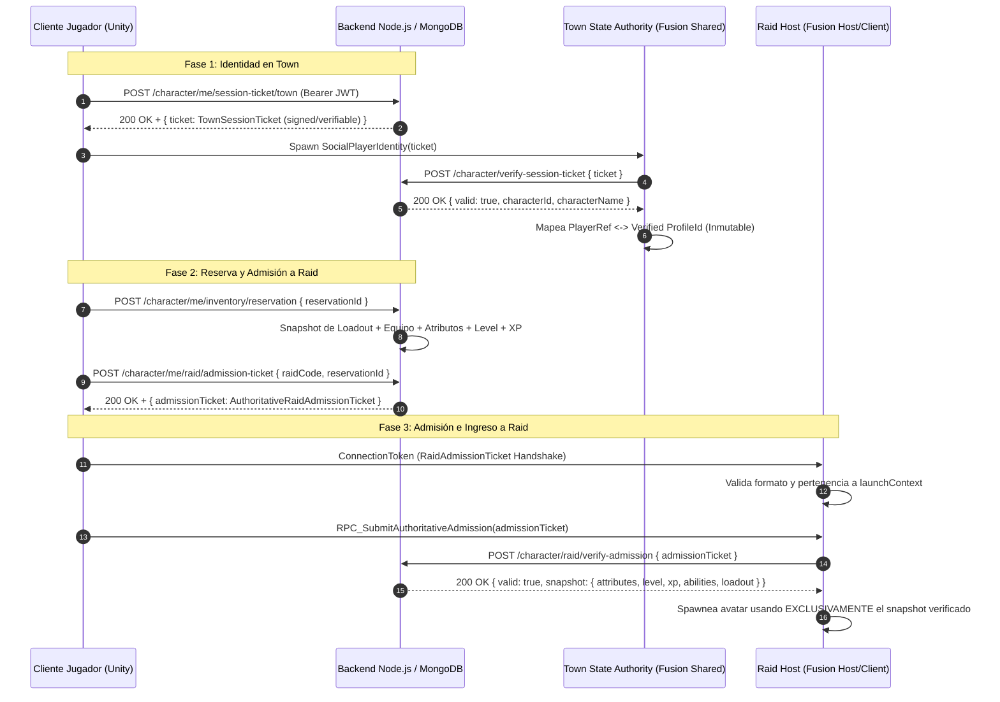

# Plan de Implementación: US-59 — Autenticar la identidad de Town y la admisión a Raid

> **Historia madre:** [US-59 (#527)](https://hacknplan.com) — Autenticar la identidad de Town y la admisión a Raid  
> **Tareas hijas:**  
> - [SEC-59.1 (#540)](https://hacknplan.com) — Definir el vínculo autenticado de cuenta, personaje y sesión Fusion  
> - [SEC-59.2 (#541)](https://hacknplan.com) — Usar identidad verificada para parties, comercio y cola de Town  
> - [SEC-59.3 (#542)](https://hacknplan.com) — Verificar la reserva y el estado autoritativo al admitir participantes a Raid  
> - [SEC-59.4 (#543)](https://hacknplan.com) — Validar identidad y admisión en reconexión y Host Migration  
> **Sprint:** 14  
> **Prioridad:** Urgent  
> **Fuentes autoritativas:**  
> - `Project Grimhold/Docs/Architecture/RemoteIdentityAndAuthArchitecture.md`  
> - `Project Grimhold/Docs/Architecture/TownRaidQueueArchitecture.md`  
> - `Project Grimhold/Docs/Architecture/LobbyAndSessionTransitionArchitecture.md`  
> - `Project Grimhold/Docs/Architecture/RaidParticipantArchitecture.md`  
> - `Project Grimhold/Docs/Architecture/RaidConnectivityContinuityArchitecture.md`  
> - `Project Grimhold/Docs/Architecture/HostMigrationRecoveryArchitecture.md`  
> - Tarea #400 (Deuda técnica de Dedicated Server / Confianza residual del Host)  

---

## 1. Diagnóstico del Error y Brechas Confirmadas

A partir de la auditoría de seguridad del 13/10/2026 y la inspección minuciosa del código fuente en `New-Testing`, se confirman las siguientes vulnerabilidades críticas:

### 1. Suplantación de Identidad en Town (SEC-59.2)
- **Evidencia:** `SocialPlayerIdentity.cs:28-41`, `TownPartyDirectory.cs:354-362`, `TownMerchantNetworkController.cs:157-170`.
- **Causa:** En el modo Shared de Town, cada cliente tiene State Authority sobre su propio `PlayerObject`. Al instanciarse, `SocialPlayerIdentity` copia ciegamente el `ProfileId` desde `LocalPlayerJoinContext.JoinData.ProfileId`, el cual es suministrado localmente por el cliente sin token ni prueba criptográfica.
- **Impacto:** Los componentes autoritativos de Town (`TownPartyDirectory.TryResolveSender` y `TownMerchantNetworkController.TryResolveRequester`) resuelven al emisor de un RPC leyendo únicamente `identity.ProfileId`. Un cliente malicioso puede declarar el `ProfileId` de cualquier otro jugador y:
  - Invocar `RPC_RequestLeaveParty` o `CancelOtherInvitations` para disolver o sabotear la party de la víctima.
  - Generar transacciones de comerciante imputadas a la víctima.
  - Insertarse en la cola o registros sociales haciéndose pasar por otro usuario.

### 2. Admisión a Raid con Fabricación Arbitraria de Atributos, Habilidades e Ítems (SEC-59.3)
- **Evidencia:** `RaidAdmissionDataCodec.cs:122-180`, `RaidAdmissionRules.cs:4-20`, `NetworkSpawnManager.cs:2640-2675`.
- **Causa:** Cuando un participante se une a una Raid (modo Host/Client), el cliente envía su `RaidAdmissionData` a través del RPC `RPC_SubmitAdmissionPayload`. El Host decodifica los campos declarados por el cliente: `level`, `currentExperience`, `characterAttributes` (vitality, strength, etc.), `preparedAbilities` y `reservedLoadout` (ítems y cantidades).
- **Impacto:** Las reglas de admisión (`RaidAdmissionRules.IsAdmitted`) y el validador de `NetworkSpawnManager` se limitan a comprobar:
  1. Que el `admission.ProfileId` esté dentro del cohort congelado (`launchContext.ParticipantProfileIds`).
  2. Que los IDs de los ítems existan en el catálogo local.
  3. Que los atributos cumplan los requisitos de catálogo de las habilidades declaradas.
  **Nunca verifican contra el backend** si el jugador realmente posee esos ítems en su reserva persistente (`pendingReservation`), ni si sus atributos o nivel coinciden con la base de datos de MongoDB. Un atacante puede ingresar a cualquier Raid con atributos en 99 (God-Mode), nivel máximo y 30 ítems legendarios inventados.

### 3. Robo de Avatar en Reconexión y Host Migration (SEC-59.4)
- **Evidencia:** `NetworkSpawnManager.cs:2580-2615` (`TryValidateEarlyHostMigrationToken`), `NetworkSpawnManager.cs:4515-4546` (`TryValidateReconnectToken`).
- **Causa:** Durante una reconexión a mitad de raid o una recuperación de Host Migration, el Host acepta cualquier token que contenga un `ProfileId` plano perteneciente a la sesión o al registro de desconectados (`_disconnectedRegistry`).
- **Impacto:** Si un jugador legítimo se desconecta, un cliente malicioso puede enviar un `RaidReconnectPayload` con el `ProfileId` de la víctima y el `RaidGenerationId` público de la partida, secuestrando inmediatamente el avatar y el objeto participante retenido de la víctima.

### 4. Frontera de Secretos del Emisor (SEC-59.1)
- **Causa:** En la arquitectura actual, los clientes Unity no deben poseer secretos maestros del emisor (`JWT_SECRET` o claves privadas) dentro de los ejecutables distribuidos a jugadores.
- **Solución Requerida:** La emisión de credenciales de sesión y tickets de admisión debe residir exclusivamente en el backend Node.js. La verificación en clientes (MasterClient de Town o Host de Raid) debe ejecutarse a través de:
  - Tokens de sesión autenticados emitidos por el backend verificables mediante endpoint de verificación backend (`/character/verify-session-ticket` y `/character/raid/verify-admission`), y/o
  - Pruebas criptográficas con interfaz desacoplada (`ITownSessionTicketVerifier`, `IRaidAdmissionVerifier`) para permitir verificación offline determinista en tests y verificación backend en runtime.

---

## 2. Arquitectura de Identidad y Admisión Autoritativa (SEC-59.1)



### Contratos de Datos Principales

1. **`TownSessionTicket`**:
   - `CharacterId` (`ProfileId` canonical).
   - `CharacterName` (Nombre del personaje).
   - `SessionName` (`"Lobby-Town"`).
   - `IssuedAt` (Unix Timestamp).
   - `ExpiresAt` (Unix Timestamp, TTL 15-30 minutos).
   - `Signature` (Firma HMAC/Hash emitido por el backend).

2. **`AuthoritativeRaidAdmissionTicket`**:
   - `CharacterId` (`ProfileId`).
   - `RaidCode` (Código de 6 caracteres de la expedición).
   - `ReservationId` (GUID de la reserva persistente en MongoDB).
   - `Level`, `CurrentExperience`.
   - `CharacterAttributes` (Vitality, Resistance, Strength, Dexterity, Intelligence, Luck, AvailablePoints).
   - `PreparedAbilities` (Slot 1, Slot 2).
   - `ReservedLoadout` (Items y slots asignados).
   - `IssuedAt`, `ExpiresAt`.
   - `Signature` (HMAC emitido por el backend).

3. **Prueba de Continuidad para Reconexión y Migración (`RaidContinuityProof`)**:
   - `CharacterId`, `RaidCode`, `RaidGenerationId`, `ReservationId`.
   - `SessionProof` (Token emitido originalmente para esa sesión de Raid, demostrando posesión previa de la reserva).

---

## 3. Plan de Trabajo por Tareas de HacknPlan

### Tarea 1: SEC-59.1 (#540) — Definir el vínculo autenticado de cuenta, personaje y sesión Fusion
**Objetivo:** Establecer el contrato formal, endpoints de emisión/verificación en el backend, y abstracciones de verificación en Unity sin exponer secretos del backend en clientes.

1. **Backend (`backend/src/`):**
   - **Endpoint de Ticket de Town:** `POST /character/me/session-ticket/town`
     - Autenticado vía JWT.
     - Genera un token firmado con claims: `{ accountId, characterId, characterName, sessionType: 'Town', sessionName: 'Lobby-Town', expiresAt }`.
   - **Endpoint de Verificación de Town:** `POST /character/verify-session-ticket`
     - Recibe `{ ticket }`.
     - Valida firma, vigencia y formato. Retorna `{ valid: true, characterId, characterName }` o rechazo 401/403.
   - **Endpoint de Ticket de Admisión a Raid:** `POST /character/me/raid/admission-ticket`
     - Recibe `{ raidCode, reservationId }`.
     - Verifica que el personaje posea una `pendingReservation` activa con ese `reservationId`.
     - Empaqueta el snapshot autoritativo: `level`, `experience`, `characterAttributes`, `preparedAbilities`, `items`, `preparedEquipment`.
     - Emite un ticket firmado completo con expiración (ej. 10 minutos).
   - **Endpoint de Verificación de Admisión a Raid:** `POST /character/raid/verify-admission`
     - Recibe `{ admissionTicket, raidCode }`.
     - Valida firma, vigencia, coincidencia de `raidCode`, y que la reserva coincida con la base de datos.
     - Retorna `{ valid: true, characterId, snapshot: { ... } }`.
2. **Unity Contracts (`Project Grimhold/Assets/Scripts/Networking/`):**
   - Crear struct inmutable `TownSessionTicket` y codec `TownSessionTicketCodec`.
   - Crear interfaz `ITownSessionTicketVerifier` (con implementaciones `BackendTownSessionTicketVerifier` y `MockTownSessionTicketVerifier` para tests).
   - Crear struct `AuthoritativeRaidAdmissionTicket` y su codec.
   - Crear interfaz `IRaidAdmissionVerifier` (con implementaciones `BackendRaidAdmissionVerifier` y `LocalDeterministicRaidAdmissionVerifier` para unit tests sin backend).
3. **Actualización Documental:**
   - Actualizar `Project Grimhold/Docs/Architecture/RemoteIdentityAndAuthArchitecture.md` y `LobbyAndSessionTransitionArchitecture.md` documentando el vínculo formal de identidad y la resolución de la brecha.

---

### Tarea 2: SEC-59.2 (#541) — Usar identidad verificada para parties, comercio y cola de Town
**Objetivo:** Reemplazar la resolución ciega de `ProfileId` en Town por la validación del ticket autenticado, impidiendo que un atacante suplante a otra víctima en parties o comercio.

1. **`SocialPlayerIdentity.cs`:**
   - Almacenar el `TownSessionTicket` (o token de identidad verificado).
   - Durante `Spawned()`, publicar el ticket de sesión hacia los peers/State Authority.
2. **`TownPartyDirectory.cs`:**
   - Modificar `TryResolveSender(PlayerRef player, out ProfileId profile)`:
     - En lugar de confiar en el string `identity.ProfileId`, verifica la identidad del `PlayerRef` mediante el registro de identidades autenticadas de Town (`TownIdentityRegistry` o validador de tickets).
     - Si un jugador envía un `PlayerRef` con un ticket inválido, falsificado o cuyo `ProfileId` no coincida con el ticket firmado, la resolución falla inmediatamente (`profile = default; return false;`).
   - Bloquear cualquier mutación (`RPC_RequestInvite`, `RPC_AcceptInvitation`, `RPC_RequestLeaveParty`, etc.) si el sender no posee identidad autenticada.
3. **`TownMerchantNetworkController.cs`:**
   - Modificar `TryResolveRequester(RpcInfo info, out PlayerRef requester, out ProfileId profileId)`:
     - Resolver al solicitante a través de la identidad verificada.
     - Rechazar operaciones de compra/venta si el ticket no está verificado o si intenta operar en nombre de otro perfil.
4. **Flujo de Conexión en `HubSessionLauncher.cs` / `SessionConnectionCoordinator.cs`:**
   - Al conectar a Town (`ConnectToTownAsync`), solicitar el ticket de sesión al backend (`POST /character/me/session-ticket/town`) y cargarlo en el contexto local.
   - Limpieza completa del ticket al hacer Logout (`LoginFlowController.ExecuteLogoutAsync`).
5. **Tests de Suplantación en Town:**
   - Crear tests unitarios en EditMode (`TownIdentitySecurityTests.cs`):
     - Simular un cliente hostil con un `SocialPlayerIdentity` manipulado apuntando al perfil de una víctima.
     - Verificar que `TownPartyDirectory` rechaza `RPC_RequestLeaveParty` del atacante y la party de la víctima NO se disuelve.
     - Verificar que `TownMerchantNetworkController` rechaza solicitudes de comercio con identidades falsificadas.
     - Verificar que identidades legítimas con tickets válidos operan con total normalidad.

---

### Tarea 3: SEC-59.3 (#542) — Verificar la reserva y el estado autoritativo al admitir participantes a Raid
**Objetivo:** Garantizar que la admisión a Raid valide la reserva del backend y utilice únicamente atributos, nivel, XP, habilidades e ítems verificados, rechazando payloads fabricados localmente.

1. **`RaidAdmissionRules.cs`:**
   - Extender la validación para admitir `AuthoritativeRaidAdmissionTicket`.
   - Comprobar que el ticket esté firmado, que coincida con el `launchContext.RaidCode`, y que el `ProfileId` pertenezca al cohort.
2. **`NetworkSpawnManager.cs`:**
   - En `TryHandleRemoteAdmissionPayload`:
     - Requerir `AuthoritativeRaidAdmissionTicket` (o payload con ticket verificado).
     - Validar el ticket mediante `IRaidAdmissionVerifier`.
     - **Reemplazar datos locales:** Si el ticket es válido, los datos utilizados para inicializar `NetworkRaidParticipant` y el avatar deben provenir **exclusivamente del snapshot verificado por el backend**, ignorando cualquier atributo o ítem autodeclarado por el cliente que discrepe de la reserva.
     - Si el ticket tiene firma inválida, reserva inexistente, cuenta/Raid ajena, o ítems que no coinciden con la reserva del backend: rechazar la admisión (`runner.Disconnect(player)` o retorno de fallo seguro), sin modificar la reserva ni admitir al jugador.
3. **Manejo de Errores y Recuperabilidad:**
   - Si la admisión es rechazada, dejar el estado del cliente en fallo recuperable (`SessionConnectionCoordinator` transiciona a `Failed` con rollback limpio hacia Town, sin fallback a datos locales falsos).
4. **Tests de Admisión Autoritativa:**
   - Crear `RaidAdmissionSecurityTests.cs`:
     - Test: Payload con atributos alterados (ej. fuerza 99 vs fuerza 5 en backend) -> Rechazado o forzado a snapshot autoritativo.
     - Test: Payload con ítems inventados que no existen en la reserva del backend -> Admisión rechazada.
     - Test: Ticket con `raidCode` ajeno o `reservationId` no coincidente -> Admisión rechazada.
     - Test: Ticket vencido o con firma manipulada -> Rechazado.
     - Test: Ticket legítimo verificado -> Admite al jugador con los atributos e inventario exactos de la reserva.

---

### Tarea 4: SEC-59.4 (#543) — Validar identidad y admisión en reconexión y Host Migration
**Objetivo:** Asegurar la continuidad legítima sin permitir secuestro de avatares desconectados, sin doble consumo de reservas y sin sobrescribir snapshots restaurados.

1. **Hardening de Reconexión en `NetworkSpawnManager.cs`:**
   - En `TryValidateReconnectToken`:
     - Requerir que el payload de reconexión incluya la prueba de continuidad (`SessionProof` / `ReservationId` original emitida al conectar por primera vez).
     - Verificar que el `ProfileId` y la prueba coincidan exactamente con el participante desconectado registrado en `_disconnectedRegistry`.
     - Si un atacante envía un `RaidReconnectPayload` sin la prueba de posesión de la reserva original: rechazo inmediato.
2. **Hardening de Host Migration:**
   - En `TryValidateEarlyHostMigrationToken`:
     - Requerir la prueba de identidad/admisión autorizada.
     - En `HandleHostMigrationPlayerJoined`: Reasociar el `PlayerRef` al avatar restaurado únicamente si la identidad y el token de sesión de la partida han sido validados.
     - Bloquear terminantemente `SpawnPlayer` fresco durante la ventana de recuperación (`SessionStartupMode.HostMigrationResume`).
     - Garantizar que la restauración no vuelva a consumir la reserva en el backend ni reponga recursos/vitalidad.
3. **Tests de Reconexión y Migración:**
   - Crear `RaidContinuitySecurityTests.cs`:
     - Test: Intento de reconexión de un tercer peer usando el `ProfileId` de un jugador desconectado sin la prueba de reserva -> Rechazado.
     - Test: Reconexión legítima con prueba válida -> Reasocia InputAuthority y participante retenido sin doble spawn.
     - Test: Host Migration -> Los avatares restaurados conservan el estado exacto del snapshot sin fresh spawn ni reseteo de vida/recursos.

---

## 4. Estrategia de Pruebas (TDD)

```
[Tests Backend]
├── tests/session.ticket.test.js
│   ├── Emisión de TownSessionTicket con claims y expiración correctos
│   ├── Verificación exitosa de ticket de Town válido
│   ├── Rechazo de ticket de Town manipulado, vencido o con firma corrupta
│   ├── Emisión de AuthoritativeRaidAdmissionTicket vinculada a pendingReservation
│   └── Verificación de AuthoritativeRaidAdmissionTicket contra el Character real
├── tests/integration/admission.integration.test.js
│   ├── Ciclo completo: Login -> Reservation -> Admission Ticket -> Verification
│   └── Prevención de emisión de ticket de admisión sin reserva activa

[Tests Unity EditMode]
├── Assets/Tests/EditMode/Editor/Networking/TownIdentitySecurityTests.cs
│   ├── Attacker_SpoofsVictimProfileId_TownPartyDirectoryRejectsDisband
│   ├── Attacker_InvalidSessionTicket_TownMerchantRejectsTrade
│   └── LegitimatePlayer_ValidTownTicket_AllowedPartyAndTradeOperations
├── Assets/Tests/EditMode/Editor/Networking/RaidAdmissionSecurityTests.cs
│   ├── Client_DeclaresManipulatedAttributes_AdmissionRejectsOrOverwritesFromBackend
│   ├── Client_DeclaresUnreservedLoot_AdmissionRejected
│   ├── Client_MismatchedRaidCodeOrReservationId_AdmissionRejected
│   └── Client_ValidAuthoritativeTicket_AdmittedWithExactReservedState
└── Assets/Tests/EditMode/Editor/Networking/RaidContinuitySecurityTests.cs
    ├── Impostor_TriesToReconnectAsDisconnectedProfile_RejectedWithoutSessionProof
    ├── LegitimateReconnect_PreservesRetainedParticipant_NoFreshSpawn
    └── HostMigration_ResumeRestoresState_DoesNotDoubleConsumeReservation
```

---

## 5. Criterios de Aceptación y Validación de Cierre

| Criterio | Validación |
| :--- | :--- |
| **Identidad en Town no falsificable** | Ningún peer puede actuar en nombre de otro `ProfileId` en `TownPartyDirectory` o `TownMerchantNetworkController`. Pruebas falsificadas o ausentes se rechazan antes de cualquier mutación. |
| **Protección contra disolución maliciosa de Party** | Ataques de suplantación no disuelven la party de la víctima ni alteran su comercio/cola. |
| **Admisión a Raid autoritativa** | Ítems, atributos, nivel, XP y habilidades adoptados en Raid coinciden 100% con la reserva autorizada por el backend. Payload inventado es rechazado. |
| **Continuidad segura en Reconexión y Host Migration** | No hay robo de avatares desconectados, ni doble consumo de reserva, ni sobrescritura de snapshots restaurados por fresh spawns. |
| **Sin secretos de emisor en builds de jugadores** | Ni `JWT_SECRET` ni claves privadas del backend se compilan dentro del cliente Unity. |
| **Preservación del flujo legítimo** | El recorrido legítimo `MainMenu -> Town -> Preparación -> Raid -> Town` opera con fluidez y sin regresiones. |
| **Suite de pruebas verde** | Todos los tests del backend (`npm test`, `npm run test:integration`, `npm run test:concurrency`) y los tests de Unity EditMode pasan limpiamente. |
