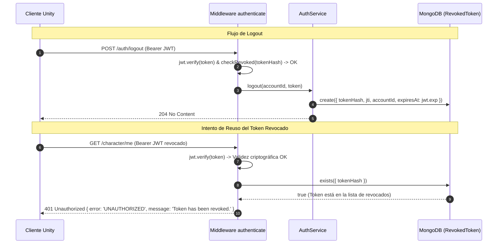

# Plan de Implementación: US-60 — Revocar sesiones y endurecer el backend productivo

> **Historia madre:** [US-60 (#528)](https://hacknplan.com) — Revocar sesiones y endurecer el backend productivo  
> **Tareas hijas:**  
> - [SEC-60.1 (#544)](https://hacknplan.com) — Implementar revocación efectiva de la sesión al cerrar sesión  
> - [SEC-60.2 (#545)](https://hacknplan.com) — Limitar intentos y abuso de recursos en login y registro  
> - [SEC-60.3 (#546)](https://hacknplan.com) — Cerrar rutas de desarrollo y sanear errores del backend productivo  
> - [SEC-60.4 (#547)](https://hacknplan.com) — Validar hardening de autenticación y límites productivos de punta a punta  
> **Sprint:** 14  
> **Prioridad:** High  
> **Fuentes autoritativas:**  
> - `Project Grimhold/Docs/Architecture/RemoteIdentityAndAuthArchitecture.md` (especialmente §Logout Lifecycle y §Stateless JWT & Revocation)  
> - `Project Grimhold/Docs/Architecture/LobbyAndSessionTransitionArchitecture.md`  
> - Auditoría local de seguridad del 13/10/2026  
> - Tareas de hardening previas: #237 (lifecycle de sesión), #238 (expiración/logout), #403 (unificación de extracción) y #413 (secretos productivos)  

---

## 1. Diagnóstico del Error y Brechas Confirmadas

A partir de la auditoría de seguridad del 13/10/2026 y la inspección del código fuente vigente en el backend Node.js y el cliente Unity, se confirman las siguientes brechas críticas:

### 1. Logout Sin Revocación del Lado del Servidor (SEC-60.1)
- **Evidencia en código:**
  - `backend/src/services/AuthService.js:64-69`:
    ```javascript
    static async logout(accountId, token) {
      // No-op for MVP. The token will expire naturally based on jwtExpiresIn.
      return true;
    }
    ```
  - `backend/src/middleware/authenticate.js:21-24`: Únicamente verifica firma y expiración matemática vía `jwt.verify(token, config.jwtSecret)`.
- **Impacto:** Los JWTs son completamente stateless. Si un jugador pulsa "Cerrar sesión" en Unity, el cliente descarta localmente el token, pero dicho token sigue siendo 100% válido en el backend hasta que transcurran los 3600 segundos (`JWT_EXPIRES_IN`). Si el token fue interceptado o extraído de la memoria/disco de un equipo compartido, un atacante puede seguir realizando llamadas autenticadas (consultar personajes, modificar inventario, unirse a raids) sin que el logout tenga efecto protector real.

### 2. Ausencia de Throttling y Abuso de Recursos en Login y Registro (SEC-60.2)
- **Evidencia en código:**
  - `backend/src/routes/auth.routes.js:9-30`: Rutas `/auth/login` y `/auth/register` sin middleware de limitación de tasa (rate limiting).
  - `backend/src/services/AuthService.js:22,43`: Operaciones con `bcrypt.hash` y `bcrypt.compare` (10 rondas de salt), de alto consumo de CPU.
  - `backend/src/app.js`: No tiene configurado `trust proxy`.
- **Impacto:** Un atacante puede emitir miles de solicitudes por segundo contra `/auth/login` o `/auth/register`. Esto causa dos vectores de ataque:
  1. *Agotamiento de CPU / DoS:* Bloqueo del event loop de Node.js por cálculo intensivo de bcrypt.
  2. *Fuerza bruta / Credential Stuffing:* Intentos ilimitados de adivinar contraseñas de cuentas existentes sin penalización ni bloqueo temporal.

### 3. Rutas de Debug Abiertas y Saneamiento Incompleto de Errores 500 (SEC-60.3)
- **Evidencia en código:**
  - `backend/src/config/env.js:12`:
    ```javascript
    const nodeEnv = process.env.NODE_ENV || 'development';
    ```
    Si `NODE_ENV` está ausente o mal escrito en producción (e.g. `prod`, `Production`), el sistema asume silenciosamente `development`.
  - `backend/src/routes/inventory.routes.js:136,178`:
    Endpoints `/me/inventory/extraction` (extracción legacy sin firma) y `/debug/mock-fusion-result` (inyección arbitraria de recompensas y equipo) solo comprueban `if (env.nodeEnv === 'production')`. No son opt-in; están activas por defecto en cualquier entorno que no sea textualmente `'production'`.
  - `backend/src/middleware/errorHandler.js:12-29`:
    ```javascript
    const statusCode = err.statusCode || 500;
    const response = {
      error: err.errorCode || 'INTERNAL_SERVER_ERROR',
      message: err.message || 'An unexpected error occurred.',
    };
    if (err.details) response.details = err.details;
    ```
    Si ocurre una excepción no controlada en la base de datos (e.g., `MongoServerError`, errores de conexión o validaciones de esquema crudas), `err.message` y `err.details` se envían textualmente al cliente HTTP, exponiendo nombres de colecciones, rutas internas o credenciales en cadenas de conexión.

---

## 2. Decisiones de Arquitectura y Contratos Técnicos

### A. Revocación Persistente de Tokens con TTL Index (SEC-60.1)

Para revocar JWTs sin romper la escalabilidad horizontal ni depender de servicios externos no configurados (como Redis), se implementa un modelo dedicado en MongoDB:



#### Especificación del Modelo `RevokedToken`:
- **Colección:** `revoked_tokens`
- **Campos:**
  - `tokenHash` (`String`, `required`, `unique`, `index`): Hash SHA-256 en hexadecimal del string del token JWT. Almacenar el hash (64 caracteres) en lugar del token completo ahorra memoria y evita retener material criptográfico completo.
  - `jti` (`String`, `index`, `sparse`): Identificador único de JWT (UUIDv4) embebido en el payload del token.
  - `accountId` (`ObjectId`, `ref: 'Account'`, `required`, `index`): Cuenta propietaria del token.
  - `expiresAt` (`Date`, `required`): Momento exacto en que el JWT expira de forma natural (`decoded.exp * 1000`).
    - **Índice TTL:** `RevokedTokenSchema.index({ expiresAt: 1 }, { expireAfterSeconds: 0 })`.
    - **Garantía:** MongoDB purga automáticamente los registros cuyo `expiresAt` ya pasó. La colección nunca crece indefinidamente y no requiere cron jobs de limpieza.
  - `revokedAt` (`Date`, `default: Date.now`).
  - `reason` (`String`, `default: 'logout'`).

#### Emisión con `jti` en `AuthService.js`:
- Tanto en `register` como en `login`, el payload del JWT incluirá un identificador único:
  ```javascript
  const jti = crypto.randomUUID();
  const token = jwt.sign({ sub: account._id, jti }, config.jwtSecret, {
    expiresIn: config.jwtExpiresIn + 's'
  });
  ```

#### Aislamiento de Sesiones Múltiples:
- Si un usuario inicia sesión en dos dispositivos simultáneamente (A y B), cada uno recibe un JWT con diferente `jti` y `tokenHash`.
- Cerrar sesión en el dispositivo A revoca únicamente el `tokenHash` de A. La sesión del dispositivo B sigue plenamente activa y válida, satisfaciendo el criterio de *"sin invalidar involuntariamente otras sesiones/cuentas"*.

---

### B. Middleware de Rate Limiting y Protección contra Abuso (SEC-60.2)

Se implementa un rate limiter de ventana deslizante (*sliding window*) de alta eficiencia en memoria pura de Node.js, **sin agregar dependencias externas de npm** (siguiendo estrictamente las reglas del repositorio):

#### Doble Llave de Limitación:
1. **Límite por Dirección IP (`req.ip`):**
   - Aplica a `/auth/login` y `/auth/register`.
   - Ventana base: 15 minutos (`AUTH_RATE_LIMIT_WINDOW_MS`, default `900000` ms).
   - Máximo de intentos: 30 solicitudes por IP (`AUTH_RATE_LIMIT_IP_MAX`, default `30`).
2. **Límite por Cuenta/Usuario (`req.body.username`) en Login:**
   - Aplica únicamente a intentos fallidos de `/auth/login`.
   - Máximo de fallos consecutivos: 5 intentos (`AUTH_RATE_LIMIT_USER_MAX`, default `5`).
   - Si las credenciales son correctas, el contador de intentos fallidos del usuario se restablece a cero inmediatamente.

#### Configuración Segura de Proxy (`trust proxy`):
- En `config/env.js`: `trustProxy: process.env.TRUST_PROXY || false`.
- En `app.js`: Si `config.trustProxy` está definido, se aplica `app.set('trust proxy', config.trustProxy)`.
- **Invariante de Seguridad:** Por defecto (`false`), Express solo confía en la IP de la conexión directa y descarta cabeceras `X-Forwarded-For` arbitrarias inyectadas por atacantes para evadir el bloqueo.

#### Contrato HTTP de Rechazo (429 Too Many Requests):
- **Headers:** `Retry-After: <segundos_restantes>`
- **Body:**
  ```json
  {
    "error": "TOO_MANY_REQUESTS",
    "message": "Too many requests. Please try again later.",
    "retryAfter": 900
  }
  ```
- **Diseño para Tests:** El middleware expone métodos para inyectar un proveedor de reloj (`nowProvider: () => Date.now()`) y limpiar el almacén (`resetRateLimits()`), permitiendo tests unitarios deterministas sin esperas reales de 15 minutos.

---

### C. Endurecimiento de Entorno, Rutas de Debug y Manejo de Errores (SEC-60.3)

#### Validación Estricta de Entorno (`config/env.js`):
1. **Lista blanca de entornos permitidos:** `['development', 'test', 'staging', 'production']`. Cualquier valor no reconocido detiene el arranque con código de error 1.
2. **Reglas para `production`:**
   - `JWT_SECRET` debe tener longitud mínima de 32 caracteres y no coincidir con cadenas triviales (`secret`, `dev-secret`, etc.).
   - `WEBHOOK_SECRET` no puede ser el valor por defecto.
   - Si `NODE_ENV === 'production'`, las herramientas de depuración quedan inhabilitadas forzosamente.
3. **Herramientas de Depuración Opt-In:**
   - `enableDebugRoutes: process.env.ENABLE_DEV_DEBUG_ROUTES === 'true' && nodeEnv !== 'production'`
   - `enableLegacyExtraction: process.env.ENABLE_LEGACY_EXTRACTION === 'true' && nodeEnv !== 'production'`
   - Si las flags no están presentes, los endpoints no están disponibles incluso en desarrollo local.

#### Saneamiento de Errores HTTP 500 (`errorHandler.js`):
- Si `statusCode >= 500` o si ocurre una excepción no capturada:
  - Se registra el error detallado internamente en servidor (`console.error('[UnhandledError]', err)`).
  - La respuesta al cliente se higieniza invariablemente:
    ```json
    {
      "error": "INTERNAL_SERVER_ERROR",
      "message": "An unexpected error occurred."
    }
    ```
  - Se remueven `err.message` crudos de base de datos, `err.details`, consultas y trazas de pila.
- Si `statusCode < 500` (errores de dominio como 400, 401, 404, 409, 429):
  - Se mantiene el código de error semántico (`errorCode`), mensaje descriptivo y `details` (e.g. validaciones de campos).

---

### D. Adaptación y Reconciliación en Unity (SEC-60.1 / SEC-60.4)

1. **Flujo de Logout en Unity (`LoginFlowController.cs`):**
   - `ExecuteLogoutAsync()` invoca `AuthenticationClient.PostLogoutAsync(_config, token)`.
   - El backend revoca el token en MongoDB y responde `204 No Content`.
   - Unity resetea el stash (`ApplicationStashServiceBootstrapper.ResetForLogout()`) y limpia el contexto (`ApplicationAuthContext.Instance.Clear()`).
2. **Manejo de Respuestas 401 / Revocación Externa:**
   - Si cualquier llamada autenticada desde Unity recibe `401 Unauthorized` (por token revocado o expirado), los clientes backend reconocen el código y permiten que `ApplicationAuthContext` limpie el estado local sin generar excepciones no controladas ni dejar datos residuales de la sesión anterior.

---

## 3. Plan Paso a Paso por Tarea

### Tarea 1: SEC-60.1 (#544) — Revocación de Sesión al Cerrar Sesión
1. **Crear Modelo `backend/src/models/RevokedToken.js`:**
   - Esquema con `tokenHash`, `jti`, `accountId`, `expiresAt` (con índice TTL `expireAfterSeconds: 0`), `revokedAt`, `reason`.
2. **Actualizar `backend/src/services/AuthService.js`:**
   - Embeber `jti` (UUID) en el payload firmado en `login` y `register`.
   - Implementar `logout(accountId, token)`: calcular SHA-256 de `token`, extraer `exp` y persistir en `RevokedToken`.
3. **Actualizar `backend/src/middleware/authenticate.js`:**
   - Tras verificar el JWT con `jwt.verify`, calcular el hash del token y consultar `RevokedToken.exists({ tokenHash })`.
   - Si existe, abortar con `401 Unauthorized` (`errorCode: 'UNAUTHORIZED'`, `message: 'Token has been revoked.'`).
   - Inyectar `req.accountId`, `req.token`, `req.jti`.
4. **Pruebas Automatizadas Unitarias:**
   - Crear `backend/tests/session.revocation.test.js`:
     - Token revocado falla en `authenticate`.
     - Token no revocado pasa `authenticate`.
     - Dos sesiones de la misma cuenta: revocar una no afecta a la otra.
     - TTL y campos del modelo.

### Tarea 2: SEC-60.2 (#545) — Rate Limiting en Login y Registro
1. **Crear Middleware `backend/src/middleware/rateLimiter.js`:**
   - Implementar limitador sliding window en memoria con clave combinada:
     - IP limiter para `/auth/login` y `/auth/register`.
     - User limiter para intentos fallidos de `/auth/login`.
   - Proveedor de tiempo inyectable (`nowProvider`) y función de reseteo (`resetRateLimits`) para pruebas.
   - Retorno de status 429 con cabecera `Retry-After`.
2. **Integrar en `backend/src/app.js` y `backend/src/routes/auth.routes.js`:**
   - Configurar `app.set('trust proxy', config.trustProxy)`.
   - Aplicar el middleware de limitación en las rutas de login y registro.
   - En login exitoso, resetear contador de fallos del usuario.
3. **Pruebas Automatizadas Unitarias:**
   - Crear `backend/tests/rate.limiter.test.js`:
     - Solicitudes dentro del límite son aceptadas.
     - Superar el límite por IP devuelve 429 con cabecera `Retry-After`.
     - Intentos fallidos por usuario bloquean solo a ese usuario.
     - Login exitoso resetea el contador del usuario.
     - Avance del reloj simulado restablece los permisos.

### Tarea 3: SEC-60.3 (#546) — Rutas de Debug y Saneamiento de Errores
1. **Endurecer `backend/src/config/env.js`:**
   - Validación estricta de `NODE_ENV` contra lista blanca.
   - Validación de entropía de `JWT_SECRET` en producción.
   - Configuración de flags opt-in `enableDebugRoutes` y `enableLegacyExtraction`.
2. **Proteger Rutas en `backend/src/routes/inventory.routes.js`:**
   - Verificar `env.enableLegacyExtraction` en `/me/inventory/extraction` (404 si está deshabilitada).
   - Verificar `env.enableDebugRoutes` en `/debug/mock-fusion-result` (404 si está deshabilitada).
3. **Sanear `backend/src/middleware/errorHandler.js`:**
   - Si `statusCode >= 500`, registrar log en consola y responder invariablemente con objeto limpio `{ error: 'INTERNAL_SERVER_ERROR', message: 'An unexpected error occurred.' }`.
4. **Pruebas Automatizadas Unitarias:**
   - Crear `backend/tests/env.hardening.test.js`:
     - Fallo en inicio con entorno inválido o secreto inseguro.
     - Verificación de flags opt-in.
     - Rechazo 404 de rutas debug cuando no están habilitadas.
     - Higienización de errores 500 (verificar que no se filtran detalles de base de datos ni stack traces).

### Tarea 4: SEC-60.4 (#547) — Validación de Hardening de Punta a Punta
1. **Crear Suite de Integración E2E (`backend/tests/integration/auth.hardening.integration.test.js`):**
   - Ejecutar flujo completo contra MongoDB:
     - Registro -> Login -> Petición autenticada exitosa -> Logout -> Petición autenticada rechazada (401).
     - Sesiones independientes concurrentes.
     - Throttling en API real.
     - Rechazo de endpoints debug bajo configuración productiva.
     - Respuestas 500 saneadas ante fallos simulados de DB.
2. **Validación en Unity:**
   - Crear suite de EditMode tests: `Assets/Tests/EditMode/Editor/Backend/AuthenticationSecurityTests.cs`.
   - Validar que `LoginFlowController.ExecuteLogoutAsync` limpia adecuadamente el estado local.
   - Validar que respuestas 401 y 429 son reconocidas y manejadas de forma segura.
   - Comprobar compilación limpia en Unity (0 errores de consola).
3. **Actualización de Documentación de Arquitectura:**
   - Actualizar `Project Grimhold/Docs/Architecture/RemoteIdentityAndAuthArchitecture.md` documentando el mecanismo de revocación persistente, contratos 429 y política de errores productivos.

---

## 4. Matriz de Cobertura de Criterios de Aceptación

| Tarea | Criterio de Aceptación (HacknPlan) | Mecanismo de Implementación |
| :--- | :--- | :--- |
| **SEC-60.1** | Tras logout exitoso, el token correspondiente no accede a rutas protegidas. | `RevokedToken` almacena `tokenHash`; `authenticate.js` comprueba existencia y rechaza con 401. |
| **SEC-60.1** | La revocación sobrevive reinicio y múltiples instancias; sesiones independientes conservan su validez. | Persistencia en colección MongoDB `revoked_tokens` compartida; tokens con `jti` y hash únicos por sesión. |
| **SEC-60.1** | Tokens inválidos/vencidos/revocados fallan sin mutaciones; Unity limpia el estado local. | Rechazo atómico en middleware antes de controladores; `ApplicationAuthContext.Clear()` en Unity. |
| **SEC-60.1** | Tests por interfaz pública prueban logout, token anterior, nueva sesión y aislamiento. | `auth.hardening.integration.test.js` y `session.revocation.test.js`. |
| **SEC-60.2** | Intentos abusivos se acotan y devuelven el rechazo documentado sin procesar trabajo costoso. | `rateLimiter.js` intercepta la solicitud antes de `bcrypt` y retorna 429 con cabecera `Retry-After`. |
| **SEC-60.2** | Login/registro saludables continúan utilizables. | Umbrales amplios para uso legítimo (30 req / 15 min por IP; 5 fallos por usuario). |
| **SEC-60.2** | La clave de limitación y confianza de proxy son seguras. | `req.ip` seguro con `trust proxy` desactivado por defecto; control explícito en `config/env.js`. |
| **SEC-60.2** | Pruebas con reloj controlado cubren límite, recuperación y aislamiento. | `rate.limiter.test.js` con `nowProvider` inyectable. |
| **SEC-60.3** | Arranque productivo sin entorno/secrets válidos falla; no habilita desarrollo silenciosamente. | Validación estricta de `NODE_ENV` y entropía de `JWT_SECRET` en `config/env.js`. |
| **SEC-60.3** | Rutas debug/mock/legacy se rechazan en producción, incluidos aliases y llamadas autenticadas. | Rutas opt-in condicionadas a `enableDebugRoutes` / `enableLegacyExtraction`; 404 en producción. |
| **SEC-60.3** | Errores HTTP 500 devuelven contrato público estable sin errores crudos de DB ni stack traces. | `errorHandler.js` sanitiza todas las respuestas con `statusCode >= 500`. |
| **SEC-60.4** | Validación de hardening de autenticación y límites de punta a punta. | Suite completa `auth.hardening.integration.test.js` + `AuthenticationSecurityTests.cs` en Unity. |

---

## 5. Validación y Verificaciones Previas

Antes de iniciar la codificación:
- Confirmar que la suite actual de tests (`npm test`, `npm run test:integration`, `npm run test:concurrency`) se encuentre en verde (baseline 231/231 passing).
- El backend corre actualmente con Node.js y MongoDB; no se agregarán paquetes externos a `package.json`.
- Unity se encuentra sincronizado en la rama `New-Testing`.
- Se requiere aprobación explícita del usuario para iniciar la fase de implementación.
